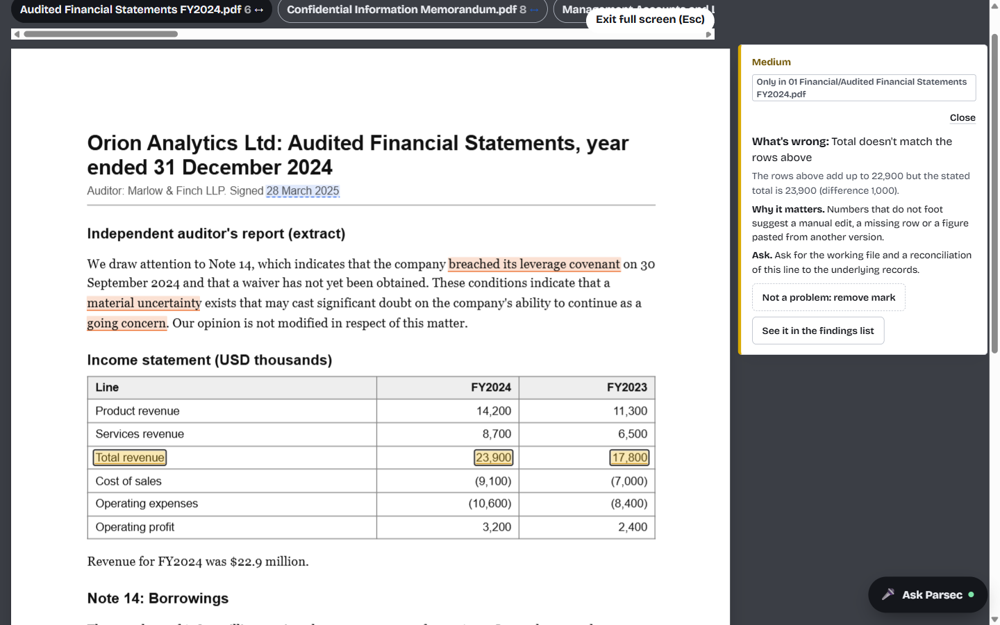
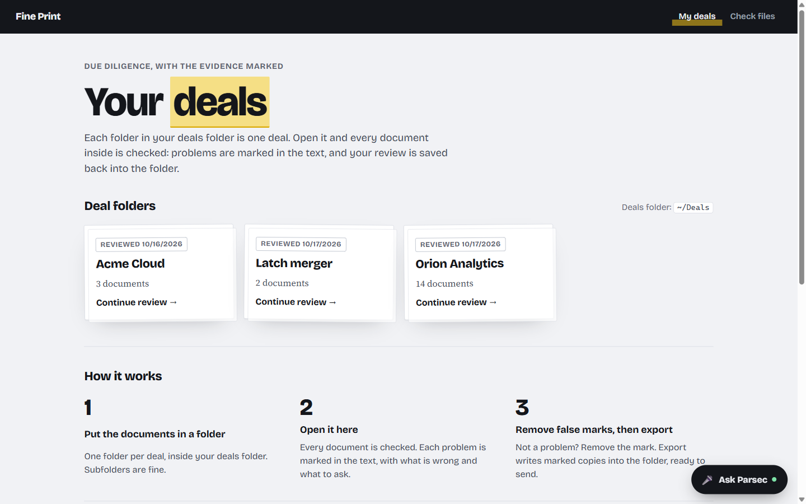
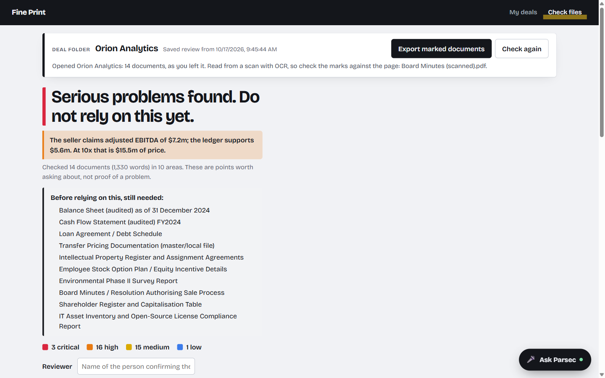
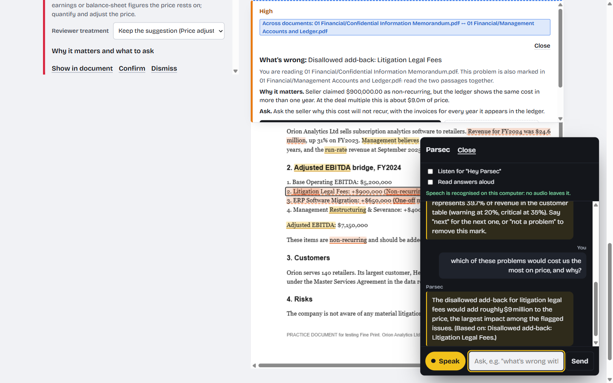
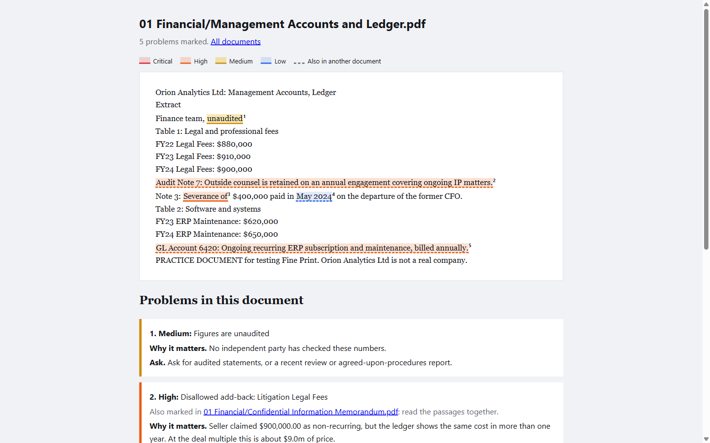
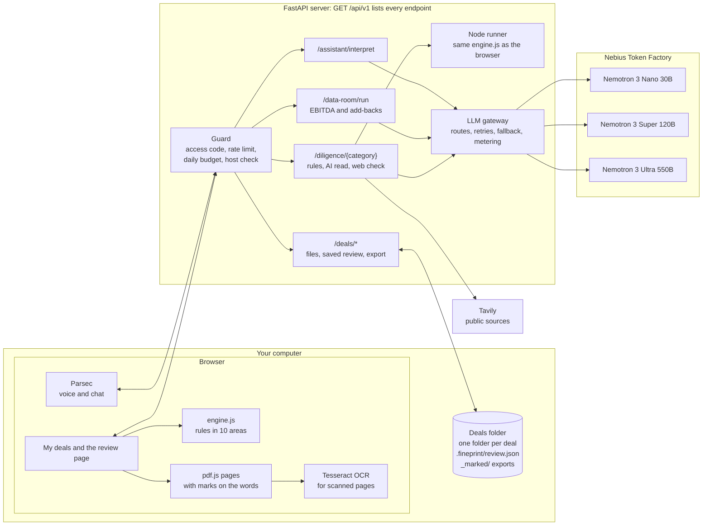
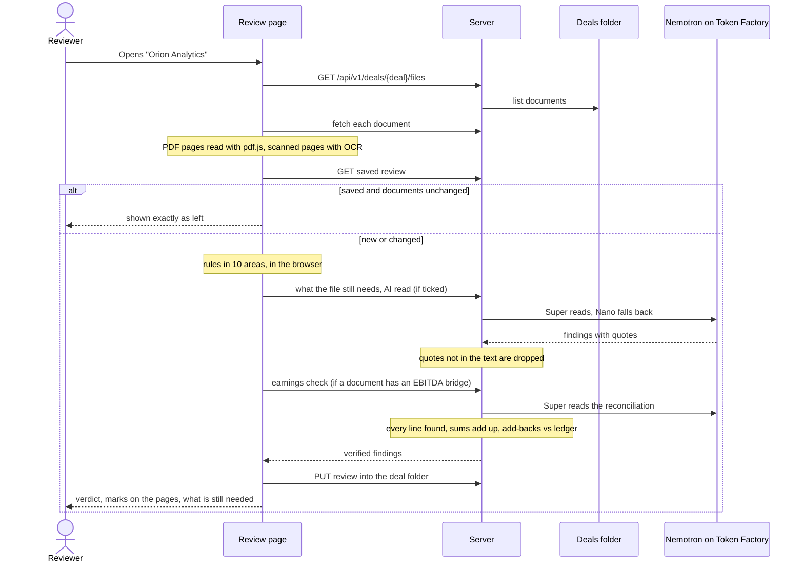
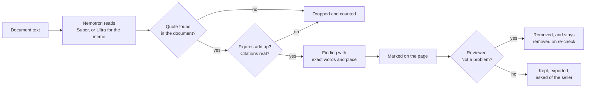
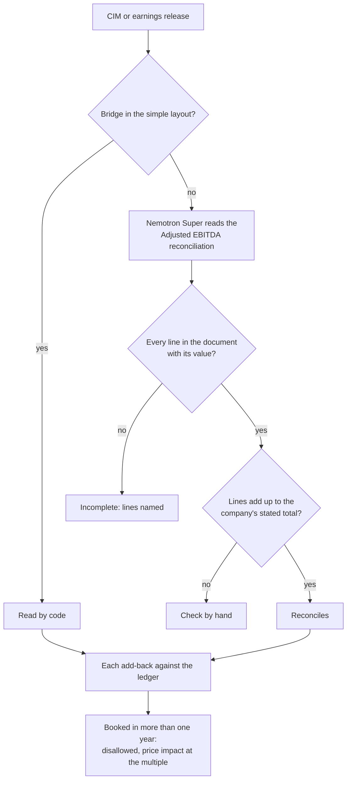
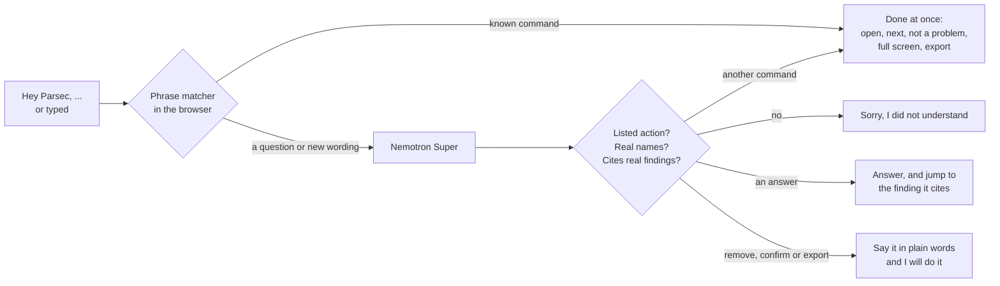

<div align="center">

# Fine Print

### Due diligence with the evidence marked

Open a deal folder. Every document is checked, every problem is marked on the page it came from,<br>
and **NVIDIA Nemotron on Nebius Token Factory** reads what rules cannot, without ever being trusted blindly.

[](LICENSE)


Built for the **Nebius × NVIDIA Global AI Hackathon**.



</div>

---

## Contents

- [The problem](#the-problem)
- [What Fine Print does](#what-fine-print-does)
- [How NVIDIA Nemotron is used](#how-nvidia-nemotron-is-used)
- [How Nebius Token Factory accelerated the work](#how-nebius-token-factory-accelerated-the-work)
- [Architecture](#architecture)
- [Workflows](#workflows)
- [Quick start](#quick-start)
- [Deploy for free](#deploy-for-free)
- [Using it](#using-it)
- [Talking to Parsec](#talking-to-parsec)
- [API](#api)
- [Measured results](#measured-results)
- [Tests](#tests)
- [Repository layout](#repository-layout)
- [Security and privacy](#security-and-privacy)
- [Known limits](#known-limits)
- [License](#license)

---

## The problem

Before a company is bought, the buyer gets 30 to 90 days to check it. The seller puts its documents into a **data room**
(contracts, accounts, customer lists, tax letters, leases), and a mid-sized deal holds 5,000 to 12,000 of them. Lawyers,
accountants and specialists each read their part, and what they find either lowers the price, adds protection to the
contract, or stops the deal.

AI review tools exist, but reviewers report the same two problems with them: **answers that are not tied to the source**,
and **false flags** they cannot easily remove. Fine Print is built around the opposite rule:

> **The model proposes. Code decides what is kept.** Every Nemotron answer is checked against the documents by plain
> code (quotes must be in the text, figures must add up, citations must exist). What fails is dropped and counted.

## What Fine Print does

| | |
|---|---|
| **Deal folders** | One folder per deal, or **upload your own folder or files from the browser** to make a new deal. Opening a deal checks every document (PDF, Word, text, HTML, CSV) in ten due diligence areas: financial, legal, compliance, technology, people, property, tax, customers, suppliers and document integrity. |
| **Marks on the real page** | PDFs are shown as their original pages with each problem marked on its words: 🟥 critical, 🟧 high, 🟨 medium, 🟦 low. Select a mark to see what is wrong, why it matters and what to ask. |
| **Across documents** | When documents disagree (revenue $24.6m in the CIM, $22.9m in the audited accounts), the problem is marked in both, and selecting it opens the other document at the matching passage. |
| **Earnings quality** | When a document carries an Adjusted EBITDA bridge, Nemotron reads it and code checks every add-back against the ledger: costs called "one-off" that recur every year are disallowed, with the price impact at the deal multiple. |
| **What is missing** | Nemotron Super reads the opening and headings of each document and lists, in analysts' terms, what to request before relying on the file. |
| **Not a problem** | Remove a false mark with one click (or by voice). It stays removed, even when the documents change and are checked again. |
| **Saved and exported** | The review is saved into the deal folder as you work. *Export marked documents* writes a highlighted, numbered copy of each document and a summary into the folder and **downloads them as a zip**, ready to send. |
| **Scanned PDFs** | Pages that are only images are read with OCR (Tesseract, served by this server, so scans never leave the machine), and marked like any other page. |
| **Parsec, the assistant** | On every page, typed or spoken: *"Hey Parsec, open Orion"*, *"what's wrong with the customer schedule?"*, *"which problem costs us most on price?"*, *"full screen"*, *"not a problem"*, *"export"*. |

<table>
<tr>
<td width="50%"></td>
<td width="50%"></td>
</tr>
<tr>
<td><sub><b>My deals.</b> Each folder in the deals folder is one deal.</sub></td>
<td><sub><b>A deal at a glance.</b> The verdict, the earnings check and what the file still needs.</sub></td>
</tr>
<tr>
<td></td>
<td></td>
</tr>
<tr>
<td><sub><b>Parsec.</b> A free question answered by Nemotron Super, citing the finding it rests on.</sub></td>
<td><sub><b>Exported marked copy.</b> Opens in any browser and prints to PDF.</sub></td>
</tr>
</table>

---

## How NVIDIA Nemotron is used

Fine Print uses the **NVIDIA Nemotron 3** family (open models) through **Nebius Token Factory**. Each task is routed
to the smallest model that does it well, with a fallback model if the first gives no answer. All routes live in one
file, [`config/models.yaml`](config/models.yaml), and every call goes through one gateway,
[`packages/gateway/llm.py`](packages/gateway/llm.py), which retries, falls back, meters tokens and prices each call.

| Step in the product | Model (fallback) | Route | What code checks before anything is shown | Cost seen |
|---|---|---|---|---|
| **What the file still needs** | Nemotron 3 **Super** 120B (Nano) | `document_requirements_json` | An item that names a supplied document, or a heading inside one, is downgraded instead of reported missing | about 1¢ per set |
| **Clause pass** over the whole contract | **Super** (Nano) | `clause_verification_json` | The model must quote the passage it tags; a quote not inside that passage is discarded | $0.49 for 30 contracts |
| **AI deep read** (generic) | **Super** (Nano) | `document_review_json` | Every finding must quote the document verbatim, or it is dropped and counted | $0.46 for 30 contracts |
| **EBITDA bridge reading** | **Super** (Nano) | `ebitda_bridge_json` | Every line must be found in the document with its value, and the lines must add up to the company's stated total | about $0.005 per release |
| **Findings memo** | Nemotron 3 **Ultra** 550B (Super) | `findings_memo_json` | Every point must cite a finding (F1…) or a request (N1…); any number must appear in the evidence it cites | about $0.02 |
| **Committee questions** for an acquisition | **Ultra** (Super) | `ic_simulator` | Built only from findings already verified in code | cents |
| **Parsec**, for wording its phrase matcher does not know | **Super** (Nano) | `assistant_command_json` | Only listed actions, only real folder and document names, answers must cite real findings; it never removes, confirms or exports by itself | about $0.0005 per question |

**Why three tiers.** Nemotron 3 **Nano** 30B is the fallback for every Super route and the fast tier;
**Super** 120B does the reading, where accuracy matters and calls are many; **Ultra** 550B writes the memo and the
committee questions, where one careful call is worth more. Two further tiers were built and **measured, then switched
off** because they did not pay: Nano triage skipped nothing on long documents, and Ultra rulings on Super's findings
cost about 3.7× for no measured gain.

**What we learned from the models:** Ultra
sometimes returns its reasoning instead of the answer (fixed with `/no_think` and an explicit instruction); Super can
spend its whole token budget reasoning on long batches (the clause route now has 8,000 tokens and an empty answer is
reported and retried on the fallback); quotes come back with curly quotes and non-breaking hyphens, so quote matching
normalises them; and Nano answered *"which problem hurts the price most?"* by repeating the question, so Parsec runs on
Super.

## How Nebius Token Factory accelerated the work

- **One OpenAI-compatible endpoint for three model sizes.** Nano, Super and Ultra answer on the same
  `/v1/chat/completions` API with one key, so a 200-line gateway serves every task, and moving a task to another model
  is one line of YAML. No GPUs, containers or model servers to run.
- **Cheap enough to measure honestly.** Benchmarks were run many times on development and held-out halves of real data
  (CUAD contracts, SEC earnings releases): $0.49 for the held-out clause pass on 30 contracts, about half a cent per
  earnings release. That made it practical to tune on one half, test once on the other, and keep every result file.
- **`usage` on every reply.** Token counts come back with each answer, so every call is priced from
  `pricing_per_million_tokens` in `config/models.yaml`, charged to a daily budget, and refused when the budget is spent
  (`packages/review/guard.py`).
- **Fallbacks that keep the product working.** When a model returns nothing (a reasoning model out of tokens) or an
  error, the gateway retries and then asks the fallback model. The product says plainly when no model answered:
  **nothing is simulated**.
- **Parallel calls.** The clause pass sends numbered passage batches concurrently, and the deep read reads document
  parts in parallel under a concurrency limit.

**Other services and open-source parts:** Nebius Token Factory is the Nebius service used. Public-source checks use
[Tavily](https://tavily.com). In the browser: [pdf.js](https://github.com/mozilla/pdf.js) (Apache-2.0) draws PDF pages,
[mammoth](https://github.com/mwilliamson/mammoth.js) (BSD-2) reads Word files, and
[tesseract.js](https://github.com/naptha/tesseract.js) (Apache-2.0) reads scans. Benchmarks use
[CUAD](https://www.atticusprojectai.org/cuad) (CC BY 4.0) and public SEC filings.

---

## Architecture



- **The rules run in the browser** (`apps/review/engine.js`) and, for the API, on the server through the very same file
  (`packages/review/rules_runner.js`), so the two can never disagree.
- **Nemotron reads only what the reviewer asks for**: with every AI option unticked, no document text is sent to a model.
- **Deal folders are on your disk.** The server only reads and writes inside the deals folder (`DEALS_DIR`, default
  `~/Deals`), and refuses any path that would leave it.

**What code checks before a model's answer is shown:**

| Model output | Check | On failure |
|---|---|---|
| A finding's quote | Must be found in the document part it came from (curly quotes and odd hyphens normalised) | Dropped and counted |
| A clause tag | Its quote must be inside the numbered passage it names | Discarded |
| A reconciliation line | Label and value on one document line; lines must add up to the stated total, in `Decimal` | Marked incomplete, or "check by hand" |
| A memo point | Must cite real findings or requests; every number must appear in the cited evidence | Point removed |
| A missing-document item | Compared with the supplied documents' names and headings | Downgraded to "unclear" |
| A Parsec command | Action from a fixed list; names that exist; answers cite real findings; never removes, confirms or exports on its own | Refused, or the user is asked to say it plainly |

## Workflows

### Opening a deal



### The model proposes, code decides



### The earnings check



### What Parsec does with what you say



---

## Quick start

**You need:** Python 3.11+, Node.js 20+ (the server runs the rules engine with it), a
[Nebius Token Factory](https://studio.nebius.com) API key for the Nemotron features, and optionally a
[Tavily](https://app.tavily.com) key for public-source checks. Chrome or Edge for voice.

```bash
git clone <this repository> && cd <this repository>
python -m venv .venv
source .venv/bin/activate                 # Windows: .venv\Scripts\activate
pip install -r requirements-dev.txt

cp .env.example .env                      # then add NEBIUS_API_KEY (and TAVILY_API_KEY)
python scripts/check_env.py --live        # confirms each key works; prints no secrets

python scripts/fetch_ocr.py               # optional: OCR for scanned PDFs (about 11 MB, served locally)
python scripts/make_pdf_testpack.py --deals   # optional: a complete practice deal in ~/Deals

python -m uvicorn apps.api.main:app --host 127.0.0.1 --port 8000
```

Open **<http://127.0.0.1:8000>**. On Windows use `127.0.0.1` rather than `localhost` if the page does not load.

| Setting (`.env`) | What it is for |
|---|---|
| `NEBIUS_API_KEY` | Nemotron on Nebius Token Factory: what the file still needs, AI read, clause pass, earnings reading, memo, Parsec's free questions |
| `TAVILY_API_KEY` | Public-source checks on the companies named in the documents |
| `DEALS_DIR` | Where deal folders live (default `~/Deals`) |
| `REVIEW_API_TOKEN` | Optional access code for the paid endpoints and for deal-folder access; set it whenever others can reach the server |
| `REVIEW_RATE_PER_MINUTE`, `REVIEW_DAILY_BUDGET_USD` | Rate limit and daily spending cap for model calls (defaults 6 and $2.00) |
| `ALLOWED_HOSTS` | Host names the server answers to (default `127.0.0.1`, `localhost`, `[::1]`) |
| `DEAL_UPLOADS` | `on` (default) lets visitors add their own folder or files as a new deal; `off` hides it |
| `DATABASE_URL` | Optional PostgreSQL connection string. Uploaded documents and saved reviews are also kept there and put back on start-up, so a host that wipes its disk loses nothing (`DATABASE_MAX_MB`, default 400, caps it) |

Without keys, the rules, connections, folders, export and OCR still work, and every AI feature says that it did not run.
Nothing is ever simulated.

**Docker:** `docker build -f infra/docker/Dockerfile -t fineprint . && docker run --env-file .env -p 8000:8000 fineprint`
(the image includes Node for the rules runner, the OCR engine and the downloadable practice deal; mount a folder and
set `DEALS_DIR` to use your own deal folders).

## Deploy for free

[](https://render.com/deploy?repo=https://github.com/Kunsh162007/PARSEC)

The repository includes a [`render.yaml`](render.yaml) blueprint for Render's **free** web service. 512 MB is enough:
measured at the largest request the API accepts (ten 200,000-character documents, all ten areas), the server peaks at
about **175 MB**, because PDF pages, OCR and the review page's rules run in the visitor's browser. The blueprint limits
parallel rules runs to two (`RULES_CONCURRENCY`) to keep the worst case well inside the limit.

1. Click the button (or *New → Blueprint* in Render and pick this repository).
2. Enter `NEBIUS_API_KEY` (and optionally `TAVILY_API_KEY` and an access code, `REVIEW_API_TOKEN`).
3. Open the `onrender.com` address once the build finishes. The deal list starts empty: *Check your own documents as
   a deal* uploads a folder or files from the visitor's computer into a new deal, and *Export* downloads the marked
   copies as a zip. Visitors without documents to hand use *Download the practice deal* (the 14 Orion Analytics PDFs,
   one of them scanned), unzip it and add its folder.

On the free plan the service sleeps after 15 minutes without visits and takes about a minute to wake, and its disk is
wiped whenever it restarts, including after sleeping. Without `REVIEW_API_TOKEN`, anyone with the address can use the
AI features until `REVIEW_DAILY_BUDGET_USD` ($2 a day by default) is spent.

**Every visitor gets a demo code.** The home page gives each new visitor a random code such as
`PARSEC-7KQ2-9XWM-4TBD-H3NA`, or they type their own (at least 12 letters or numbers). Their uploaded deals, their
review of every deal (the practice deal included) and their marked copies are kept under that code: entering it on
another device, or opening `https://<your-app>.onrender.com/?demo=<code>`, brings the same work back, and nobody else
sees it. The server stores only a digest of each code. *Remove* on their own deals deletes them and frees the space;
the practice deal can be neither changed nor removed from the page.

**Keeping uploads and reviews across restarts.** Create a free PostgreSQL database (for example on
[Neon](https://neon.tech)), copy its connection string and set it as `DATABASE_URL` on the service. Every uploaded
document and saved review is then written to the database before the disk, and put back when the service starts, so
a judge's deal is still there after the service has slept. Marked copies are made again by *Export*.

**Open to anyone, or behind an access code.** For a public demo, leave `REVIEW_API_TOKEN` empty: visitors go
straight in with their demo code, and spending is still capped by the daily budget and the rate limit. To keep the
site private, set it and send people a link that carries it, `https://<your-app>.onrender.com/?code=<access code>`.
The page keeps it for the tab and removes it from the address bar; anyone opening the plain address is asked once.

## Using it

1. **Make a deal.** On *My deals*, use *Check your own documents as a deal* to choose a folder (subfolders are kept) or
   files from your computer, or create a folder in the deals folder (for example `~/Deals/Orion Analytics`) and put the
   documents in it. Or run `python scripts/make_pdf_testpack.py --deals` for **Orion Analytics**, a complete
   practice data room of 14 PDFs with planted problems in every area, including one scanned document.
2. **Open it** from *My deals*. Every document is read and checked; the deal bar says when it was saved.
3. **Read the verdict**, the earnings line and *Before relying on this, still needed*, then go through the findings.
   *Questions to send* lists one question per problem; *Deal tracker* gives the request list and Q&A log as CSV.
4. **Open the Document view.** Problems are marked on the original pages; a dashed mark is also in another document.
   Select a mark to see what is wrong; *Open …* jumps to the other document; *Not a problem* removes the mark.
5. **Export marked documents** to write highlighted copies and `summary.html` into the deal's `_marked` folder; they
   download as a zip as well.
6. *Check files* (in the menu) checks a few files without a folder; nothing is uploaded unless an AI option is ticked.


## Talking to Parsec

Press **Ask Parsec** (bottom right) and type, press **Speak**, or switch on **Listen for "Hey Parsec"**.

| Say | Parsec |
|---|---|
| *open Orion* · *list my folders* | Opens a deal, or names your deals |
| *what's wrong with the customer schedule* | Opens that document at its most serious problem and explains it |
| *next problem* · *go back* · *read that again* | Walks through the problems, most serious first |
| *not a problem* · *bring it back* · *confirm* | Removes a false mark, undoes that, or confirms a real one |
| *show the tax problems* · *show the document* | Filters by area, or switches view |
| *full screen* · *zoom in* · *scroll down* · *exit full screen* | Reading comfort |
| *export* · *print* · *go home* | Exports marked copies, prints, returns to My deals |
| *which problem would cost us most on price, and why?* | **Nemotron Super** answers from the verified findings and jumps to the one it cites |

Common commands are understood instantly in the browser (`apps/review/assistant.js`); anything else goes to Nemotron.
Where the browser can recognise speech on the device, no audio leaves the computer; otherwise Parsec asks before using
the browser's online speech service. Documents are never sent to it.

---

## API

Everything is a child of **`GET /api/v1`**, which lists every endpoint, its group and whether it can spend money.
Interactive docs: <http://127.0.0.1:8000/docs>.

| Endpoint | What it does | Paid |
|---|---|---|
| `GET /api/v1/diligence/categories` | The 10 categories, each with its own path | no |
| `POST /api/v1/diligence/{category}` | One category (`financial`, `legal`, `compliance`, `tech`, `people`, `property`, `tax`, `commercial`, `supply`, `integrity`): rules, plus `"ai": true` for the Nemotron read and `"web": true` for that category's public-source questions | with `ai`/`web` |
| `POST /api/v1/diligence` | Several categories at once | with `ai`/`web` |
| `POST /api/v1/diligence/requirements` · `/memo` · `/deep` | What the file still needs, the cited memo, the cross-category AI read | yes |
| `GET /api/v1/deals` · `/deals/{deal}/files` · `/deals/{deal}/files/{path}` | Deal folders and their documents | no |
| `PUT /api/v1/deals/{deal}/files/{path}` · `GET /deals/{deal}/export.zip` | Add a document (creates the deal); download the marked copies | no |
| `DELETE /api/v1/deals/{deal}` | Remove a deal you added (shared deals cannot be removed) | no |
| `GET`/`PUT /api/v1/deals/{deal}/review` · `POST /deals/{deal}/export` | Saved review; marked copies into the folder | no |
| `POST /api/v1/data-room/run` · `GET /data-room/{id}` | The earnings and add-back check | yes |
| `POST /api/v1/assistant/interpret` | Parsec's Nemotron fallback | yes |
| `GET /api/v1/companies/lookup` · `/benchmarks/*` · `/status` · `/health` | Public-source check, saved benchmark results, server status | lookup only |

```bash
curl -X POST http://127.0.0.1:8000/api/v1/diligence/legal -H "Content-Type: application/json" \
  -d '{"documents":[{"name":"msa.txt","text":"The Customer may terminate on a change of control. Liability is unlimited."}]}'
```

Each finding names its `documents`, sets `cross_document` when the documents disagree, and carries spans with `start`,
`end` and `text` (Unicode code points). The older `/api/review/*` and `/api/deals/*` paths still answer and are marked
deprecated.

## Measured results

Every figure comes from a script in this repository run on real data; the result files are kept in `benchmarks/`.
Tuning was done on one half of each dataset and tested once on the held-out half.

| What | Data | Result |
|---|---|---|
| Rules, 15 clause categories | CUAD: 255 held-out real contracts, labelled by lawyers | recall **27% → 58%** after tuning on the other half |
| Rules + **Nemotron Super** clause pass | 30 held-out contracts, 136 labelled clauses | recall **80%** (rules alone 54%), $0.49, 0 failed calls |
| **Nemotron Super** reading Adjusted EBITDA reconciliations | 20 fresh real 8-K earnings releases, never seen before | **16 read completely and add up, 0 misread**; the old pattern extraction read 0 |
| Cost of reading a reconciliation | same | about **$0.005** per release |
| Ultra second opinion, Nano triage | same contracts | measured, no gain, **switched off** |

Not measured: whether Fine Print would have caught a fraud before it came out. It is a due diligence worker, not a
fraud oracle.

```bash
python -m benchmarks.cuad.dataset --fetch                  # CUAD contracts (106 MB, checksum verified)
python -m benchmarks.cuad.run --split test                 # rules on the held-out half (free)
python -m benchmarks.cuad.verify_run --split test --n 30   # rules + Nemotron Super clause pass (about $0.50)
python -m benchmarks.ebitda.fetch && python -m benchmarks.ebitda.run --split test   # earnings releases from SEC EDGAR
```

## Tests

```bash
python -m pytest -q     # 364 tests: API, deal folders, uploads, export, assistant, rules runner, web check, gateway, pipeline...
npm test                # 138 tests: rules engine, connections, workflow, assistant parser, earnings, PDF marks
```

Most tests use small hand-written inputs; integration tests use FinanceBench and FinQA samples in `backtest/`. They
check behaviour; accuracy is measured separately on real data, above.

## Repository layout

```
apps/
  api/          FastAPI: the /api/v1 parent endpoint, deal-folder routes, security headers and guard
  home/         My deals page; Parsec (voice.js) and the navigation shared by every page
  review/       The review page: engine.js rules, pdfview.js pages, deals.js, assistant.js, earnings.js, tests
  web/          The original PARSEC dashboard (still served at /parsec/)
packages/
  gateway/      Nebius Token Factory client: routing, retries, fallback model, metering
  review/       AI read, clause pass, requirements, memo, web check, assistant, guard, server-side rules
  deals/        Deal folders on disk and the marked export
  workflow/     The earnings pipeline and the Nemotron reconciliation reader (bridge.py)
  compute/ evidence/ schemas/ tavily/ common/
config/         models.yaml (every Nemotron route and price), thresholds, sector playbooks
benchmarks/     CUAD, SEC earnings releases, requirements samples, fraud-case documents: runners and results
scripts/        check_env.py, fetch_ocr.py, make_pdf_testpack.py
docs/images/    the screenshots in this README
demo/deals/     Orion Analytics, the practice deal offered as a download (/api/v1/practice-deal.zip)
render.yaml     free deployment on Render
tests/          unit and integration tests
```

## Security and privacy

- **No document text reaches a model** unless an AI option is ticked or Parsec is asked something it must pass on.
- **Every model answer is verified** before it is shown: quotes, sums, citations and names, as above.
- **Paid endpoints are guarded**: optional access code, per-client rate limit, and a daily budget charged with the real
  cost of each call.
- **Deal folders are confined**: names and paths that would leave the deals folder are refused; writes are atomic; only
  `127.0.0.1`, `localhost` and `[::1]` are answered by default, which stops DNS-rebinding attacks from other websites.
- **Pages are hardened**: content security policy, no `innerHTML` with document text, exported copies escape all text.
- **Scans and speech stay local where they can**: OCR runs in the browser from this server; on-device speech is used
  when the browser offers it.


## Known limits

- The rules are English-only patterns. They point at what to ask; they are screening, not legal advice.
- The generic AI read covers about the first 96,000 characters of a request; the clause pass and the rules read
  everything.
- Marks on PDFs are placed from the text layer and letter widths; on unusual fonts a mark can be a little off.
- OCR reads the first 40 scanned pages of a document, a few seconds per page, and can misread (for example "Lid" for
  "Ltd"); the deal bar says which documents were read by OCR.
- Browsers allow true full screen only after a click or key press; a spoken "full screen" fills the window and the next
  click completes it.
- Without `REVIEW_API_TOKEN`, anyone who can reach the server can use it; it listens only on this computer by default.

## License

Fine Print is released under the **[Apache License 2.0](LICENSE)**. Third-party parts keep their own licences:
pdf.js and tesseract.js (Apache-2.0), mammoth (BSD-2-Clause), the CUAD dataset (CC BY 4.0). NVIDIA Nemotron models are
used through Nebius Token Factory under their own terms.
